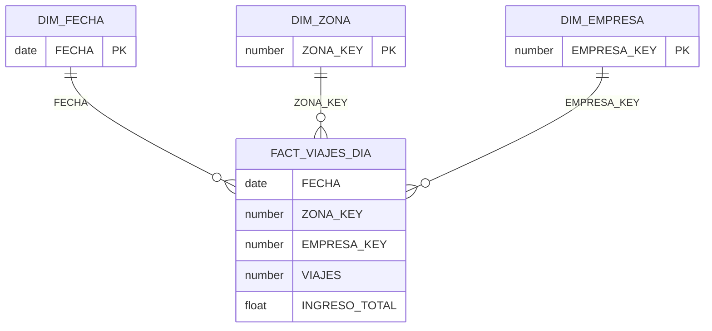

# Diagrama de la estrella · Taller 1

Equipo: <nombres>

Grano (el mismo de la primera línea de `01_estrella.sql`): <una fila por ... >

Reemplaza el diagrama de abajo por el de tu estrella: una tabla de hechos al centro y al menos dos
dimensiones, cada una con su clave. GitHub dibuja el bloque `mermaid` al abrir este archivo. Si
prefieres una imagen, súbela como `diagrama.png` a esta carpeta y deja aquí un enlace a ella.

## Claves

| Dimensión | Clave | Por qué es única |
|---|---|---|
| DIM_FECHA | <...> | <...> |
| DIM_ZONA | <...> | <...> |
| DIM_EMPRESA | <...> | <...> |
