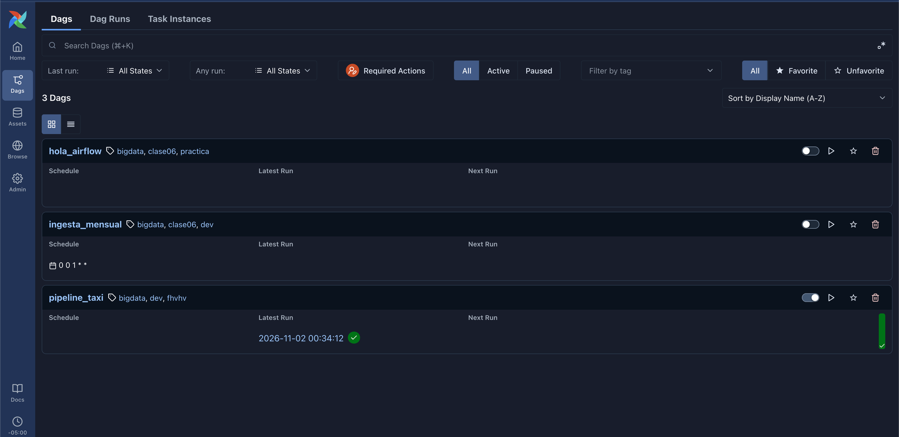
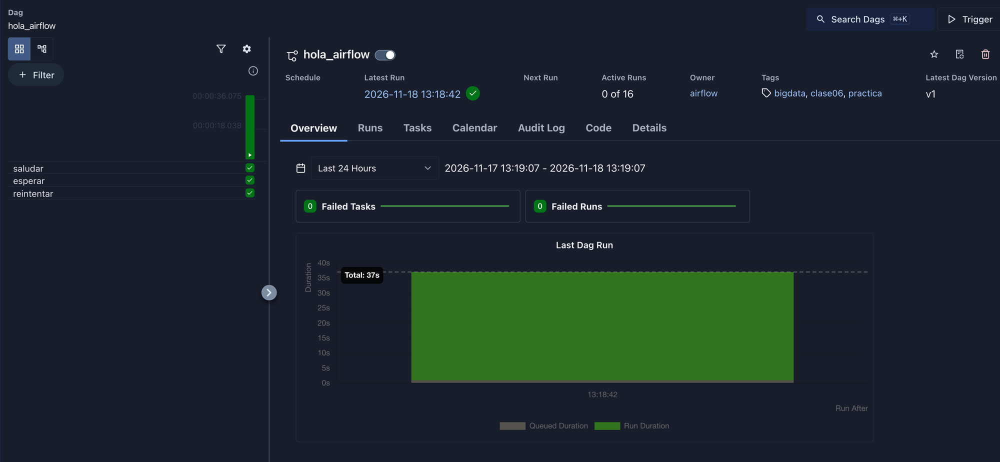
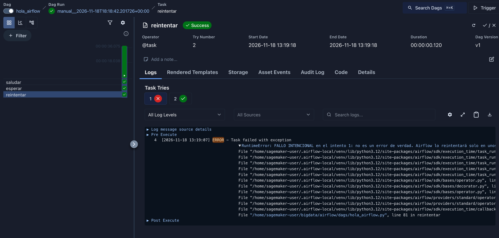
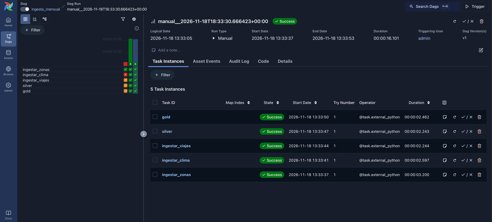
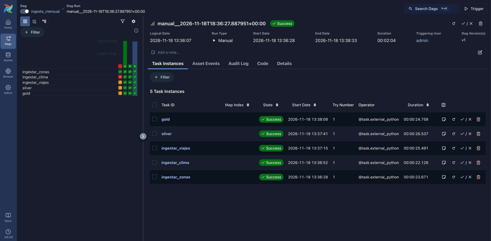

# Airflow, primeros pasos (hoja de ayuda de la clase 6)

Airflow es el programa que ejecuta nuestras tareas en el orden correcto, deja registro de cada intento y reintenta cuando algo falla. Un **DAG** es la receta: una lista de tareas con sus dependencias, escrita como un archivo de Python en `airflow/dags/`.

Hoy practicamos con `hola_airflow`: tres tareas (`saludar`, `esperar`, `reintentar`), sin Spark, sin Snowflake y sin red. Después usamos `ingesta_mensual`, que ya trae tus funciones de la clase 5.

## 1. Encender, revisar y apagar

Cada bloque empieza con `cd ~/bigdata` para que funcione sin importar dónde esté la terminal.

```bash
cd ~/bigdata && bash scripts/airflow-local.sh up
```
Equivale a `make airflow-local`. Si quieres ver qué haría el `make` sin ejecutarlo: `make -n airflow-local` imprime `bash scripts/airflow-local.sh up`. La primera vez instala Airflow 3.3.2 con Python 3.12 y en el Code Editor tardó 59 segundos; las siguientes es más rápido. Al terminar imprime el usuario, la contraseña y la dirección de la interfaz.

```bash
cd ~/bigdata && make airflow-local-estado
```
Muestra la salud (`metadatabase`, `scheduler`, `triggerer` y `dag_processor` deben decir `healthy`) y la memoria. Tras arrancar quedan disponibles unos 3.8 GB de 7.8 GB. Ojo: la cifra «Airflow ... MB» que imprime el script suma memoria compartida; no es lo que Airflow consume de verdad. Si Airflow no responde, dice «Airflow no responde en 8080».

```bash
cd ~/bigdata && make airflow-local-down
```
Detiene Airflow y el servidor web que lo acompaña. Apágalo cuando termines: libera memoria para Spark.

## 2. Entrar a la interfaz

En el navegador del Code Editor, la ruta es `/codeeditor/default/ports/8080/` pegada a la dirección de tu espacio (`https://<id-del-space>.studio.<región>.sagemaker.aws/codeeditor/default/ports/8080/`). El comando de encendido imprime la dirección completa en la línea `UI:`.

- **Usuario:** `admin`.
- **Contraseña:** la genera Airflow la primera vez y la guarda en `~/.airflow-local/home/simple_auth_manager_passwords.json.generated`. El comando de encendido la imprime en la línea `Usuario: admin  Contraseña: ...`. Para verla de nuevo:

```bash
cd ~/bigdata && jq -r '.admin' ~/.airflow-local/home/simple_auth_manager_passwords.json.generated
```

## 3. Recorrido con `hola_airflow`

1. En la lista de DAGs busca `hola_airflow`. Nace **en pausa**: activa el interruptor de la izquierda para despausarlo.

   
2. Haz clic en el nombre y luego en el botón de disparar (**Trigger**). En el formulario aparece el parámetro `mes` con el valor `2024-02`; puedes cambiarlo (el formulario exige el formato AAAA-MM). Confirma.
3. Abre la vista de **cuadrícula** (Grid): cada columna es una corrida y cada cuadro es una tarea de esa corrida. La corrida completa tarda cerca de 40 segundos (37 s en el ensayo).

   
4. Haz clic en un cuadro y abre la pestaña de **registro** (Logs). Ahí está lo que imprimió la tarea: en `saludar` verás «Mes recibido: 2024-02». En `reintentar` verás dos intentos (pestaña de intentos, Task Tries): el 1 en rojo, con el error «FALLO INTENCIONAL en el intento 1…» (la última línea del error apunta a `hola_airflow.py`, línea 81), y el 2 en verde, con «Intento 2: esta vez sí funciona…».

   
5. Para volver a ejecutar una tarea (o un DAG completo), selecciónala y pulsa **Clear**: Airflow la vuelve a poner en cola y la ejecuta de nuevo.

Con el DAG real, `ingesta_mensual`, así se ven las ejecuciones 2 y 3 de febrero en el ensayo. La primera columna roja de la cuadrícula es una corrida que Airflow lanzó solo al activar el DAG, cuando su calendario mensual todavía estaba activo: falló porque el clima de noviembre de 2026 no existe. Hoy el calendario está comentado y esa corrida no se repite.





Qué significa cada color del cuadro:

| Estado | Color | Qué quiere decir |
|---|---|---|
| `queued` | gris | Ya le tocó, pero espera que haya espacio para correr. |
| `running` | verde claro | Se está ejecutando ahora mismo. Lo verás en `esperar`. |
| `success` | verde oscuro | Terminó bien. |
| `failed` | rojo | Falló y ya no le quedan reintentos. |
| `up_for_retry` | amarillo | Falló, pero tiene un reintento pendiente: espera 10 segundos y vuelve a correr. Lo verás en `reintentar`. |
| `skipped` | rosado | No se ejecutó porque una decisión del DAG la omitió. |

Los colores pueden variar un poco según el tema de la interfaz; el nombre del estado aparece al pasar el cursor sobre el cuadro.

## Dónde quedan los datos de `ingesta_mensual`

Hoy el DAG escribe en el disco del Code Editor, no en S3: `~/datos_clase05/bronze_alumno` (zonas y clima completos; viajes, solo 1 000 filas en modo de prueba), `~/datos_clase05/silver_alumno` (1 000 filas) y `~/datos_clase05/gold_alumno` (281 filas). Es lo que cabe en el Code Editor con Airflow encendido, y alcanza para practicar el orden, los reintentos y el no duplicar. Athena no lee esas carpetas: lee el bronze del año completo que `make muestra` dejó en tu bucket de S3 en la clase 4, con los mismos archivos de la TLC que trae tu ingesta. Lo único que sale del Code Editor son los registros de la tabla de control en Snowflake. En la clase 7 las mismas funciones corren en Glue y escriben bronze, silver y gold en S3.

## 4. Los comandos de la clase

Primero prepara la terminal. Esto se hace una vez por terminal y requiere que `make airflow-local` ya haya instalado Airflow:

```bash
cd ~/bigdata
export AIRFLOW_HOME="$HOME/.airflow-local/home"
export PATH="$HOME/.airflow-local/venv/bin:$PATH"
export AIRFLOW__CORE__DAGS_FOLDER="$HOME/bigdata/airflow/dags"
export PYTHONPATH="$HOME/bigdata/airflow"
export AIRFLOW__CORE__LOAD_EXAMPLES=false
```
Cada variable tiene una razón: `AIRFLOW_HOME` es la carpeta con la base de datos de Airflow (la misma que usa la interfaz); `PATH` hace que `airflow` sea el del entorno que instaló el script; `AIRFLOW__CORE__DAGS_FOLDER` le dice dónde están tus DAGs; `PYTHONPATH` deja importar el código compartido de `airflow/`; `LOAD_EXAMPLES=false` evita llenar la lista con DAGs de ejemplo.

```bash
cd ~/bigdata && airflow dags reserialize
```
`dags` agrupa los comandos de DAGs; `reserialize` obliga a Airflow a leer de nuevo los archivos de `airflow/dags/` y guardar el resultado en su base de datos. Úsalo cuando acabas de crear o editar un DAG y no lo ves.

```bash
cd ~/bigdata && airflow dags list
```
Lista los DAGs que Airflow conoce, con su archivo y si están en pausa (`is_paused`). Deben salir `hola_airflow`, `ingesta_mensual` y `pipeline_taxi`.

```bash
cd ~/bigdata && airflow dags list-import-errors
```
Muestra los archivos que Airflow no pudo cargar y el error de Python de cada uno. Si todo está bien responde `No data found`.

```bash
cd ~/bigdata && airflow tasks test hola_airflow saludar 2024-02-02 --task-params '{"mes": "2024-05"}'
```
Ejecuta **una sola tarea** en esta terminal, sin lanzar una corrida completa. Las partes son: el DAG (`hola_airflow`), la tarea (`saludar`), una fecha lógica cualquiera (`2024-02-02`; usa una fecha distinta en cada prueba) y los parámetros en JSON (`--task-params`). Las tareas fallidas imprimen el error en pantalla. Ojo: en `tasks test` la tarea `reintentar` siempre falla, porque este comando no reintenta; para ver el reintento usa `dags test`.

```bash
cd ~/bigdata && airflow dags test hola_airflow 2024-02-01 --conf '{"mes": "2024-02"}'
```
Ejecuta **el DAG completo** en orden desde la terminal, incluidos los reintentos. `2024-02-01` es la fecha lógica de la corrida y `--conf` entrega los parámetros en JSON (aquí `mes`). Tarda unos 30 segundos y al final el registro dice que la corrida terminó.

## 5. Mini reto: rompe y arregla

1. Abre `airflow/dags/hola_airflow.py` y busca la línea `FALLAR_SIEMPRE = False` (cerca del inicio).
2. Cámbiala a `FALLAR_SIEMPRE = True` y guarda. La interfaz toma el cambio casi de inmediato; si no, corre `airflow dags reserialize`.
3. Lanza el DAG. `reintentar` pasa por `up_for_retry` y termina en `failed` (rojo). Abre su registro: el mensaje dice qué línea cambiar.
4. Regresa la línea a `False`, guarda, selecciona `reintentar` y pulsa **Clear**. Ahora debe quedar en `success`.

## 6. Errores comunes

| Qué ves | Por qué pasa | Qué hacer |
|---|---|---|
| El DAG no aparece en la lista | Airflow tarda unos minutos en leer archivos nuevos, o el archivo tiene un error | `cd ~/bigdata && airflow dags reserialize`, luego `airflow dags list-import-errors` para ver el error de Python |
| La página no carga | Airflow o el servidor web no están arriba, o la dirección no lleva la ruta completa | `cd ~/bigdata && make airflow-local-estado`; si no responde, `make airflow-local`; usa la dirección de la línea `UI:` (termina en `/codeeditor/default/ports/8080/`) |
| Se queda sin memoria (la terminal se cierra o todo va lentísimo) | Airflow y Spark juntos no caben: durante `ingesta_mensual` la memoria disponible bajó hasta unos 700 MB | `cd ~/bigdata && make airflow-local-down`, cierra los notebooks con Spark (Kernel > Shut Down) antes de lanzar el DAG y vuelve a encender |
| `database is locked` | Dos procesos escriben a la vez en la base de datos de Airflow (SQLite), por ejemplo un comando de terminal mientras corre una tarea | Espera a que termine la tarea y repite el comando; si persiste, apaga con `make airflow-local-down` y enciende de nuevo |
| En el registro de cada tarea aparece un `Traceback ... No module named 'pendulum'` | Airflow comprueba si el Python del entorno del curso tiene `pendulum` y lo anuncia con ruido | Nada: es inofensivo, la tarea sigue y termina bien. Fíjate en el estado del cuadro, no en ese texto |
| La tarea queda en `queued` | Airflow no está procesando: el planificador (scheduler) cayó o no hay espacio para ejecutar | `cd ~/bigdata && make airflow-local-estado` y mira que `scheduler` diga `healthy`; si no, apaga y enciende |
