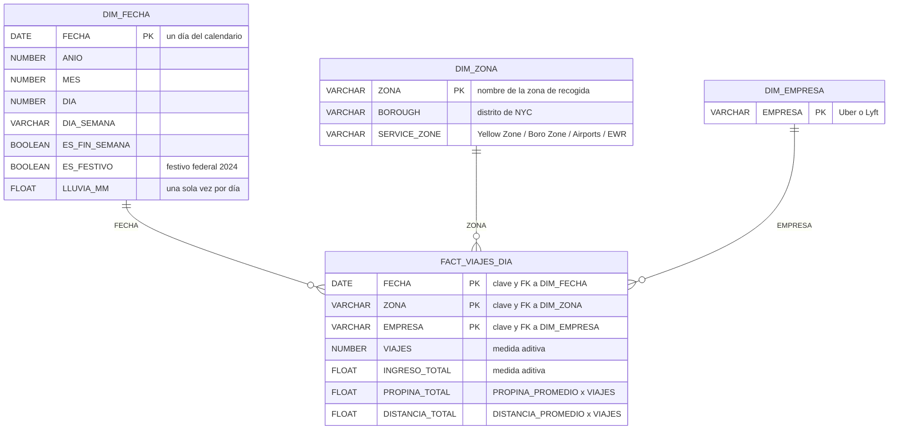

# Diagrama de la estrella · Taller 1

Equipo: Manuela Restrepo Céspedes, Ana María Montealegre Ramírez, Julian Olaya, Andrea Páez Cardona · Anfitrión: Andrea Páez Cardona · Caso A · Competencia entre plataformas

**Grano** (el mismo de la primera línea de `01_estrella.sql`): una fila por **fecha, zona de recogida y empresa**. Es decir, un día de operación de una plataforma —Uber o Lyft— en una zona de Nueva York. Son 46 715 filas y 60 268 466 viajes, de enero a marzo de 2024.

El modelo usa **claves naturales**: el hecho guarda directamente `FECHA`, `ZONA` y `EMPRESA`, que son también las claves primarias de sus dimensiones. La clave primaria del hecho es la tripleta `(FECHA, ZONA, EMPRESA)`, que es exactamente el grano.

## Claves

| Dimensión | Clave | Por qué es única |
|---|---|---|
| `DIM_FECHA` | `FECHA` | `02_carga.sql` la genera con `GENERATOR(ROWCOUNT => 91)` y un `DATEADD` por fila: un día por fila, sin repetir. Son 91 días (31 + 29 + 31, con 2024 bisiesto). |
| `DIM_ZONA` | `ZONA` | `02_carga.sql` usa `QUALIFY ROW_NUMBER() OVER (PARTITION BY ZONA ORDER BY BOROUGH, SERVICE_ZONE) = 1`, que deja una sola fila por nombre. De las 265 filas del catálogo de la TLC quedan 262. |
| `DIM_EMPRESA` | `EMPRESA` | Sale de un `SELECT DISTINCT EMPRESA` sobre el gold. No se escribieron «Uber» ni «Lyft» a mano, como exige el enunciado. Son 2 filas. |

Cada dimensión tiene **una sola fila por clave**, así que unir el hecho con cualquiera de ellas conserva las 46 715 filas: no pierde ni duplica nada. Los controles `U1`, `U2` y `U3` de `05_calidad.sql` comprueban que no hay huérfanos, y `T4f` y `T4g` que la unión con `DIM_ZONA` sigue dando 46 715 filas y 60 268 466 viajes.

## Decisiones de modelado

**1. La lluvia vive en `DIM_FECHA`, no en el hecho.** `LLUVIA_MM` es un atributo del día, no del viaje: en el gold se repite en las ~513 filas de cada fecha. Guardada una vez por día no se puede cometer el error de sumarla: el control `T1e` muestra lo que da `SUM(LLUVIA_MM)` del 10 de enero sobre el gold, frente a los 21,7 mm reales que verifica `T1d`. Por lo mismo, los días se cuentan con `COUNT(DISTINCT FECHA)` y nunca con `COUNT(*)`.

**2. El hecho guarda sumas, no promedios.** `PROPINA_PROMEDIO` y `DISTANCIA_PROMEDIO` del gold son promedios de grupo y no son aditivos: sumarlos no significa nada. El hecho guarda `PROPINA_TOTAL = PROPINA_PROMEDIO × VIAJES` y `DISTANCIA_TOTAL = DISTANCIA_PROMEDIO × VIAJES`, que sí lo son, y el promedio ponderado se rehace en cualquier nivel con `SUM(PROPINA_TOTAL) / SUM(VIAJES)`. En JFK el 24 de enero el promedio simple da 3,905 y el ponderado 3,82 (controles `T2c` y `T2a`).

**3. Los importes no se comparan con `=`.** Están redondeados a dos decimales y son `FLOAT`, y en coma flotante `0.1 + 0.2 = 0.3` devuelve falso en Snowflake (control `T3a`). Las comparaciones usan `ROUND(x, 2)` o `ABS(a - b) < 0.01`.

**4. `DIM_ZONA` tiene una fila por nombre, no por `LOCATION_ID`.** El gold identifica la zona por nombre, y el catálogo de la TLC repite dos nombres en varios identificadores: Corona en el 56 y el 57, y Governor's Island/Ellis Island/Liberty Island en el 103, 104 y 105. Unir el gold por nombre contra las 265 filas agregaría 196 filas y 184 265 viajes, un 0,3 % (controles `T4d` y `T4e`). Como los repetidos comparten distrito y tipo de zona, quedarse con una fila por nombre no pierde información (control `T4b`).
